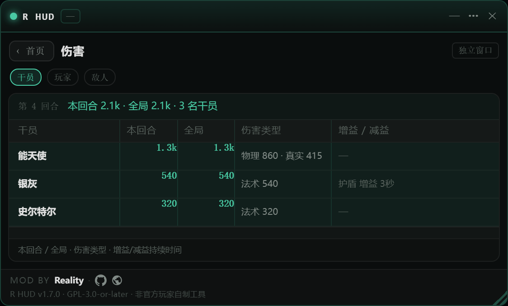
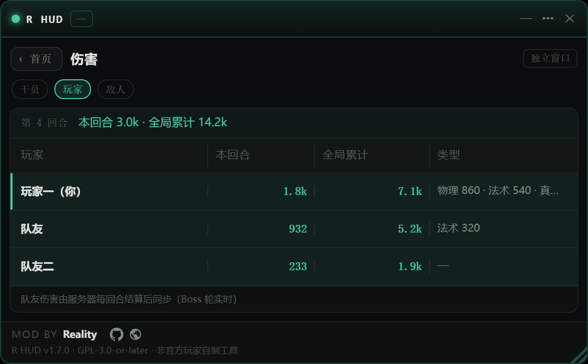

# Reality HUD

> 分页式可拖拽悬浮窗 mod，叠加在 [《卫戍协议：盟约》](https://github.com/sganggs/Stronghold-Protocol)（Stronghold Protocol，**原项目 / Upstream**）游戏页面之上：首页一屏总览连接状态、真实延迟曲线与在线人数，卡片点按进入**本局**、**免密钥邀请好友**、**伤害统计**（干员 / 玩家 / 敌方三表，可各自弹成独立窗口）、服务、性能、日志与设置各页。

[](LICENSE)
[](CHANGELOG.md)
[](#兼容性)
[](#贡献者--contributors)

**纯客户端视角**：不修改任何游戏代码，无构建步骤，无运行时依赖，随页面加载即用；游戏更新后照常工作（服务端补丁为可选增强，见下）。

| | |
|---|---|
| **作者 / Author** | **Reality**（[@xianshi3](https://github.com/xianshi3)） |
| **原项目 / Upstream** | [sganggs/Stronghold-Protocol](https://github.com/sganggs/Stronghold-Protocol) —— 《卫戍协议：盟约》浏览器游戏（Arknights 粉丝复刻，GPL-3.0-or-later） |
| **许可 / License** | [GPL-3.0-or-later](LICENSE)（与游戏本体一致） |


---

## 功能

悬浮窗是分页式的小面板：**首页**是一屏总览 + 进入各页的卡片，点卡片切页，页内左上角「‹ 首页」返回。

| 页面 | 内容 |
|---|---|
| 首页总览 | 真实延迟 RTT 大数字与 60 次采样迷你折线图（<80ms 绿 / <180ms 黄 / 其余红）、连接状态一行摘要（抖动 / 丢包 / 重连 / 时钟偏移 / 最近错误）、在线 / 房间 / 对局三个计数器；卡片上直接显示各页实时摘要 |
| 本局 | 房间码、模式、难度、席位、你的座位、阶段中文名、回合 x/14、倒计时 |
| **邀请** | **免密钥链接**：在同盟中给出 `?room=CODE` 链接，一键复制，好友打开即自动加入；**在线名单**：列出服务器上所有在线玩家（大厅 / 同盟中 / 对局中），每人一个「邀请」按钮，服务端把你的房间码定向推给对方；**收到邀请**：面板顶部弹横幅（任何页面都可见，邀请卡还会闪烁提示），点「立即加入」直接进房（已在其他同盟中则一键换房：服务端先退原房间；对局中会拒绝并说明）。旧服务端没有名单接口时自动降级（只隐藏名单，复制链接照常） |
| **伤害** | **干员 / 玩家 / 敌方三张统计表**（页内标签切换）：本回合与全局累计伤害、伤害类型、来源归属与本地化，以及增益 / 减益类型与持续时间；页头「独立窗口」把当前这张表弹成悬浮窗（拖动 / 缩放 / 折叠照旧），窗口 `×` 或停靠位的「收回」放回页面；兼容 `m.unitStats`、`b.ev`、`m.field`、`m.result` 等新旧协议帧。**队友伤害**需服务端补丁才是实时的（普通回合结算后、Boss 轮约每秒），未打补丁时队友数据在本局结算时可见；结算帧带 `settled` 时本回合与全局两列**校正为服务器值**（本地实时读数是原始命中值的估算，击杀溢出 / 元素条会略高），每回合结束后所有屏幕数字一致。**归属按战场解析**（v1.7.2）：命中与单位在自己的战场（各自场地 / 联防 / 观战）里配对，运行时单位 id 不再与干员 uid 混用——**队友帮忙防（联防）时，帮防队友的伤害记在各自干员与玩家名下，不会再「谁打都算我的」**；**v1.8.0**：服务器打上新版补丁后，正常回合 / 联防里 HUD 每 2 秒把自己的实时伤害上报给服务器、并入所有队友可见的实时行（不再是「只有结束才算伤害」）；打了补丁的服务器在命中事件里带权威来源单位 id，我打的伤害不会再显示成队友的名字（未打补丁时按攻击顺序推算、队列里出现多名不同攻击者时不猜），v1.7.1 / v1.7.2 / v1.8.0 |
| 服务 | 从公开的 `/healthz` 取：在线人数、房间数、进行中对局、AI 队友、观战、连接数、服务版本、运行时长 |
| 性能 | FPS 与帧时间。战斗在每个玩家的浏览器里本地模拟，这个数字才是低端设备卡不卡的关键 |
| 日志 | 关键帧按严重度分色：握手、房间、阶段切换、结算、房间关闭、服务端错误（含 `detail` 明细），可筛选 / 展开 / 复制 |
| 设置 | 宽度、不透明度、淡出透明度、伤害窗口字号滑条；首页显示哪些页面的开关 |
| 关于 | 作者信息、数据来源、免责声明 |


| 伤害 · 干员 | 伤害 · 玩家（队友实时同步） |
|---|---|
|  |  |

## English

**Reality HUD** is a draggable, collapsible, **page-based** floating panel (a *mod*) for the browser game
[Stronghold Protocol](https://github.com/sganggs/Stronghold-Protocol) — a non-commercial fan remake of the
Arknights「卫戍协议：盟约」co-op mode. A home page shows the connection state, real RTT with a sparkline and
server population at a glance; cards open pages for the current match, invites (**password-free `?room=`
links**, an online roster, one-tap invitations), the damage page (operator / player / enemy tables, each
poppable into its own floating window), server, FPS, an event log and
settings — without modifying a single line of game code.
GPL-3.0-or-later; the author is [@xianshi3](https://github.com/xianshi3). The interface is Chinese-first.

## 兼容性

| 场景 | 支持情况 |
|---|---|
| [上游原项目 Stronghold Protocol](https://github.com/sganggs/Stronghold-Protocol) `0.1.3` – `0.2.6` | ✅ 全部基础功能（HUD 只使用游戏公开的 `__SP__` 接口与公开 GET 端点） |
| 在线名单 + 一键邀请 | 需要服务端打上可选补丁（[`server-patch/`](docs/server-patch.md)）；**未打补丁时 HUD 自动降级**——名单栏显示提示后停止请求，复制邀请链接照常可用 |
| 队友伤害实时同步 | 同样需要服务端补丁（`reality-hud-damage.patch`）：普通回合结算后、Boss 轮约每秒把每名玩家的本回合 / 全局伤害放进 `m.public`，并给命中事件带上**权威来源 id**（我打的伤害归我名下，不再按攻击顺序猜测）；**v1.8.0 起**服务器广告 `hudRelay` 后，HUD 还会每 2 秒上报自己的实时伤害（客户端战斗的正常回合 / 联防），队友实时可见；**未打补丁时**队友数据仅在本局结算时（`m.result`）可见、归属按序推算（v1.7.2 起队列里出现多名不同攻击者时不猜、记入未归属），本地自己的伤害始终实时 |
| 未装 HUD 的原版玩家 | ✅ 完全不受影响：`room.invited` 推送对原版客户端是未知消息，会被静默忽略 |
| 安卓端（WebView 壳） | ✅ HUD 随页面加载，触屏可拖动；隐藏后点右下角 **R 浮标**唤回（v1.4.0，手机无键盘也不怕） |
| 系统 / 浏览器 | 桌面 Chrome / Edge / Firefox 优先；移动端可用（有触屏适配） |

> mod 加载器（游戏自带 `public/js/mods.js`）在启动时扫描 `public/mods/index.json` 与各文件夹的 `mod.json`，自动挂载，无需改游戏代码。

## 安装

三种方式任选其一：

1. **克隆 / 下载本仓库**（`git clone https://github.com/xianshi3/Stronghold-Protocol-Reality-HUD.git`），把文件夹放进游戏的 `public/mods/` 下并**改名为 `reality-hud`**（mod id，加载器按它索引），刷新页面；
2. 直接下载 [Releases](../../releases) 的压缩包解压到 `public/mods/`；
3. 临时体验：在游戏 URL 后加 `?mod=reality-hud`（只加载它）或 `?nomods=reality-hud`（不加载它）。

## 使用

- **拖动**：按住标题栏移动；位置、宽度、折叠、透明度记在 `localStorage`，下次打开还在原地（连同你最后停留的页面）
- **切页**：首页卡片点按进入对应页面，页内左上角「‹ 首页」返回
- **折叠**：标题栏 `—`；**隐藏**：`×`，之后点右下角的 **R 浮标**唤回（手机可直接点），桌面也可用 <kbd>Shift</kbd>+<kbd>H</kbd>
- **菜单 `…`**：常驻显示 / 迷你模式（只留延迟一行）/ 暂停采样 / 伤害统计（打开伤害页）/ 打开设置
- **伤害页（v1.7.0）**：标签切 干员 / 玩家 / 敌人；页头「独立窗口」把当前这张表弹成悬浮窗，「收回窗口」或窗口 `×` 放回页面（同一份数据来回搬，列宽与滚动位置都在）；右上「伤害文字」滑条在设置页
- **设置**：宽度、不透明度、淡出透明度、伤害字号滑条；「首页显示这些页面」开关决定哪些卡片出现在首页
- **邀请好友（v1.4.0）**：
  1. 创建或加入一个同盟，打开「邀请」页 → 复制 `?room=密钥` 邀请链接发给好友，**对方打开就自动进房，不用输密钥**；
  2. 你的房间没有在对局中时，名单里每个人的「邀请」按钮会把邀请推给对方（`room.invite` → `room.invited`）；
  3. 对方 HUD 顶部弹出横幅 → 点「**立即加入**」直接进你的同盟（对方在别的同盟里时会先退出原同盟再进来；正在对局中则无法加入）。

## 服务端补丁（可选）

两个相互独立的小补丁（都向后兼容，不打不影响任何现有功能）：

| 补丁 | 给什么 | 规模 |
|---|---|---|
| `server-patch/reality-hud-invite.patch` | 「在线名单 + 一键邀请」：`GET /api/players`（在线名单，**不含房间码 / token**）、C2S `room.invite` / S2C `room.invited`（定向推送，带限流） | 4 个文件 |
| `server-patch/reality-hud-damage.patch` | 队友伤害实时同步 + 命中归属：`m.public` 玩家行附带 `hudDmg: { round, dmg, total, settled }`（普通回合结算后、Boss 轮约每秒；`settled` 标记结算完成、各屏以它校正）；仿真伤害事件带权威来源单位 id（我打的伤害不再显示成队友的名字；原版客户端忽略多余字段 / 元组尾巴）；`hudRelay` 广告 + `m.hudDmg` 实时上报（正常回合 / 联防里队友伤害约每 2 秒实时可见） | 10 个代码文件 + 3 篇文档 + 4 个测试 |

```bash
cd Stronghold-Protocol
git apply reality-hud-invite.patch
git apply reality-hud-damage.patch
systemctl restart stronghold        # 重启后生效
```

详见 [docs/server-patch.md](docs/server-patch.md)（含各补丁内容与还原方法）。

## 数据来源与隐私

全部数据在本地渲染，**不上传任何东西**——没有遥测、没有外部请求、没有账号系统。只有两个同源只读 GET：

- `/healthz` —— 游戏本来就公开的 JSON 状态端点
- `/api/players` —— 在线名单 `{ id, name, inRoom, inMatch }`（仅在「邀请」栏可见、页面在前台时每 10 秒拉取；接口 404 时自动停用）

**房间码永远不出现在名单接口里**——它是进房钥匙，只经服务端定向推给被邀请者本人。

## 开发与测试

mod 本体是两个静态文件（`hud.js` + `hud.css`），无构建、无依赖。三个自测都用 puppeteer 驱动真实页面：

| 测试 | 命令 | 覆盖 |
|---|---|---|
| 桌面冒烟 | `npm test` | 67 项断言：挂载、首页卡片与切页、返回、页面开关、折叠、菜单、真实指针点按、伤害页（标签 / 弹窗 / 收回）、邀请页与模拟邀请横幅、日志与错误明细、隐藏唤回浮标、无页面错误…… |
| 手机模拟 | `npm run test:mobile` | 10 项断言：面板适配、浮标、触屏切页（含伤害页弹窗不溢出）与拖动（截图到系统临时目录） |
| 伤害页 | `npm run test:damage` | 自带假服务器：26 项断言——三标签 / 停靠与弹窗归位 / 累计值合并不虚高 / 跨回合回合戳 |

```bash
npm install                 # 只装 devDependency（puppeteer-core）
node server/index.js        # 在游戏仓库起一个本地服务器（默认 http://127.0.0.1:3000）
npm test                    # 桌面冒烟 67 断言
npm run test:mobile         # 手机模拟 10 断言
npm run test:damage         # 伤害页自测（不需要游戏服务器）
# Windows 以外设置 CHROME_PATH 指向 Chrome 可执行文件
```

约定：只用浏览器公开 API 与游戏公开接口；每帧预算内不碰布局读写；面板隐藏 / 暂停时停止一切定时器。

## 贡献者 / Contributors

|  |  |
|:---:|:---:|
| **Reality** · [@xianshi3](https://github.com/xianshi3)<br>作者 / 维护者 | **Kriss-wq** · [@Kriss-wq](https://github.com/Kriss-wq)<br>[实时伤害统计窗口（PR #3）](https://github.com/xianshi3/Stronghold-Protocol-Reality-HUD/pull/3) · [伤害归属修复（PR #4）](https://github.com/xianshi3/Stronghold-Protocol-Reality-HUD/pull/4) |

欢迎提 Issue 与 PR——贡献前请先读 [CONTRIBUTING.md](CONTRIBUTING.md)。

## 更新日志

见 [CHANGELOG.md](CHANGELOG.md)。

## 许可与声明

- 本 mod 以 **[GPL-3.0-or-later](LICENSE)** 发布（与所附加的游戏同协议），Copyright (c) 2026 Reality。
- 它所附加的游戏《卫戍协议：盟约》以 GPL-3.0-or-later 发布，是明日方舟 / Arknights 的**非官方粉丝作品**。本 mod 独立开发、运行时加载，**不含任何游戏代码与游戏素材**，安装它不改变游戏本体或任何游戏内容的授权。
- 与 Hypergryph、Yostar 及 Stronghold Protocol 项目作者无任何关联；非商业用途。
