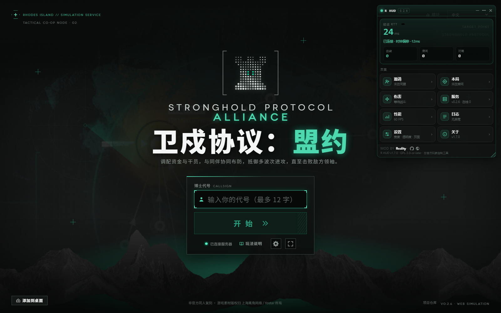
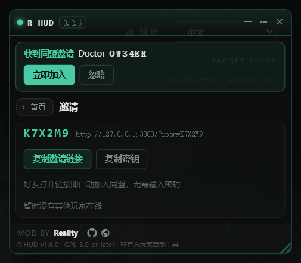

# Stronghold-Protocol-Reality-HUD

> **Reality HUD** —— 可拖拽的悬浮窗 mod，叠加在 [《卫戍协议：盟约》](https://github.com/sganggs/Stronghold-Protocol)（Stronghold Protocol，**原项目 / Upstream**）游戏页面之上：连接状态、真实延迟曲线、在线人数、本局信息、**免密钥邀请好友**、性能与事件日志，一屏看全。

[](LICENSE)
[](CHANGELOG.md)
[](#兼容性)

**纯客户端视角**：不修改任何游戏代码，无构建步骤，无运行时依赖，随页面加载即用；游戏更新后照常工作（服务端补丁为可选增强，见下）。

| | |
|---|---|
| **作者 / Author** | **Reality** |
| **GitHub** | <https://github.com/xianshi3> (`@xianshi3`) |
| **原项目 / Upstream** | [sganggs/Stronghold-Protocol](https://github.com/sganggs/Stronghold-Protocol) —— 《卫戍协议：盟约》浏览器游戏（Arknights 粉丝复刻，GPL-3.0-or-later） |
| **博客 / Blog** | <https://reality-blog.asia> |
| **许可 / License** | MIT（见 [`LICENSE`](LICENSE)） |



---

## 功能

| 分区 | 内容 |
|---|---|
| 延迟 RTT | 游戏自带心跳测出的**真实往返延迟**，60 次采样迷你折线图（<80ms 绿 / <180ms 黄 / 其余红），抖动与丢包 |
| 连接状态 | 在线 / 连接中 / 重连中 / 已断开，重连次数，最近一次错误，时钟偏移 |
| 在线玩家 | 从公开的 `/healthz` 取：在线人数、房间数、进行中对局、AI 队友、观战、连接数、服务版本、运行时长 |
| 本局 | 房间码、模式、难度、席位、你的座位、阶段中文名、回合 x/14、倒计时 |
| **邀请** | **免密钥链接**：在同盟中给出 `?room=CODE` 链接，一键复制，好友打开即自动加入；**在线名单**：列出服务器上所有在线玩家（大厅 / 同盟中 / 对局中），每人一个「邀请」按钮，服务端把你的房间码定向推给对方；**收到邀请**：面板顶部弹横幅，点「立即加入」直接进房。旧服务端没有名单接口时自动降级（只隐藏名单，复制链接照常） |
| **干员伤害统计** | 独立窗口实时显示每名干员本回合伤害、全局累计伤害、伤害类型，以及当前和最近结束的增益 / 减益与持续时间；兼容 `m.unitStats`、`b.ev`、`m.field`、`m.result` 等协议帧 |
| 性能 | FPS 与帧时间。战斗在每个玩家的浏览器里本地模拟，这个数字才是低端设备卡不卡的关键 |
| 事件日志 | 关键帧按严重度分色：握手、房间、阶段切换、结算、房间关闭、服务端错误（含 `detail` 明细），可筛选 / 展开 / 复制 |
| 关于 | 作者信息、数据来源、免责声明 |



## English

**Reality HUD** is a draggable, collapsible floating panel (a *mod*) for the browser game
[Stronghold Protocol](https://github.com/sganggs/Stronghold-Protocol) — a non-commercial fan remake of the
Arknights「卫戍协议：盟约」co-op mode. It shows the connection state, real RTT with a sparkline, server
population, the current match, invites (**password-free `?room=` links**, an online roster, one-tap
invitations), FPS and an event log — without modifying a single line of game code. MIT-licensed; the
author is [@xianshi3](https://github.com/xianshi3). The interface is Chinese-first.

## 兼容性

| 场景 | 支持情况 |
|---|---|
| [上游原项目 Stronghold Protocol](https://github.com/sganggs/Stronghold-Protocol) `0.1.3` – `0.2.6` | ✅ 全部基础功能（HUD 只使用游戏公开的 `__SP__` 接口与公开 GET 端点） |
| 在线名单 + 一键邀请 | 需要服务端打上可选补丁（[`server-patch/`](docs/server-patch.md)）；**未打补丁时 HUD 自动降级**——名单栏显示提示后停止请求，复制邀请链接照常可用 |
| 未装 HUD 的原版玩家 | ✅ 完全不受影响：`room.invited` 推送对原版客户端是未知消息，会被静默忽略 |
| 安卓端（WebView 壳） | ✅ HUD 随页面加载，触屏可拖动；隐藏后点右下角 **R 浮标**唤回（v1.4.0，手机无键盘也不怕） |
| 系统 / 浏览器 | 桌面 Chrome / Edge / Firefox 优先；移动端可用（有触屏适配） |

> mod 加载器（游戏自带 `public/js/mods.js`）在启动时扫描 `public/mods/index.json` 与各文件夹的 `mod.json`，自动挂载，无需改游戏代码。

## 安装

三种方式任选其一：

1. **克隆 / 下载本仓库**（`git clone https://github.com/xianshi3/Stronghold-Protocol-Reality-HUD.git`），把文件夹放进游戏的 `public/mods/` 下并**改名为 `reality-hud`**（mod id，加载器按它索引），刷新页面；
2. 直接下载 [Releases](../../releases) 的压缩包解压到 `public/mods/`；
3. 临时体验：在游戏 URL 后加 `?mod=reality-hud`（只加载它）或 `?nomods=reality-hud`（不加载它）。

## 使用

- **拖动**：按住标题栏移动；位置、宽度、折叠、透明度记在 `localStorage`，下次打开还在原地
- **折叠**：标题栏 `—`；**隐藏**：`×`，之后点右下角的 **R 浮标**唤回（手机可直接点），桌面也可用 <kbd>Shift</kbd>+<kbd>H</kbd>
- **菜单 `…`**：常驻显示 / 迷你模式 / 暂停采样 / 设置
- **设置**：布局预设（精简 / 标准 / 全部）、各分区显示开关、宽度与透明度滑条
- **邀请好友（v1.4.0）**：
  1. 创建或加入一个同盟，打开「邀请」栏 → 复制 `?room=密钥` 邀请链接发给好友，**对方打开就自动进房，不用输密钥**；
  2. 你的房间没有在对局中时，名单里每个人的「邀请」按钮会把邀请推给对方（`room.invite` → `room.invited`）；
  3. 对方 HUD 顶部弹出横幅 → 点「**立即加入**」直接进你的同盟。

## 服务端补丁（可选）

「在线名单 + 一键邀请」需要游戏服务器应用一个小补丁（4 个文件，向后兼容，不打也不影响任何现有功能）：

```bash
cd Stronghold-Protocol
git apply reality-hud-invite.patch   # 见 server-patch/ 与 docs/server-patch.md
systemctl restart stronghold        # 重启后生效
```

补丁内容：`GET /api/players`（在线名单，**不含房间码 / token**）、C2S `room.invite` / S2C `room.invited`（定向推送，带限流）。详见 [docs/server-patch.md](docs/server-patch.md)。

## 数据来源与隐私

全部数据在本地渲染，**不上传任何东西**——没有遥测、没有外部请求、没有账号系统。只有两个同源只读 GET：

- `/healthz` —— 游戏本来就公开的 JSON 状态端点
- `/api/players` —— 在线名单 `{ id, name, inRoom, inMatch }`（仅在「邀请」栏可见、页面在前台时每 10 秒拉取；接口 404 时自动停用）

**房间码永远不出现在名单接口里**——它是进房钥匙，只经服务端定向推给被邀请者本人。

## 开发与测试

mod 本体是两个静态文件（`hud.js` + `hud.css`），无构建、无依赖。冒烟测试用 puppeteer 驱动真实页面，40 项断言（挂载、折叠、菜单、真实指针点按菜单行、邀请栏、模拟邀请横幅、隐藏唤回浮标、无页面错误……）：

```bash
npm install                 # 只装 devDependency（puppeteer-core）
node server/index.js        # 在游戏仓库起一个本地服务器（默认 http://127.0.0.1:3000）
npm test                    # = node test/hud-smoke.mjs [URL]，桌面冒烟 40 断言
npm run test:mobile         # = node test/hud-mobile.mjs [URL]，手机模拟 7 断言（截图到系统临时目录）
# Windows 以外设置 CHROME_PATH 指向 Chrome 可执行文件
```

约定：只用浏览器公开 API 与游戏公开接口；每帧预算内不碰布局读写；面板隐藏 / 暂停时停止一切定时器。

## 更新日志

见 [CHANGELOG.md](CHANGELOG.md)。

## 许可与声明

- 本 mod 以 [MIT](LICENSE) 发布，Copyright (c) 2026 Reality。
- 它所附加的游戏《卫戍协议：盟约》以 GPL-3.0-or-later 发布，是明日方舟 / Arknights 的**非官方粉丝作品**。本 mod 是独立的衍生作品，运行时加载，**不含任何游戏代码与游戏素材**，安装它不改变游戏本体或任何游戏内容的授权。
- 与 Hypergryph、Yostar 及 Stronghold Protocol 项目作者无任何关联；非商业用途。
